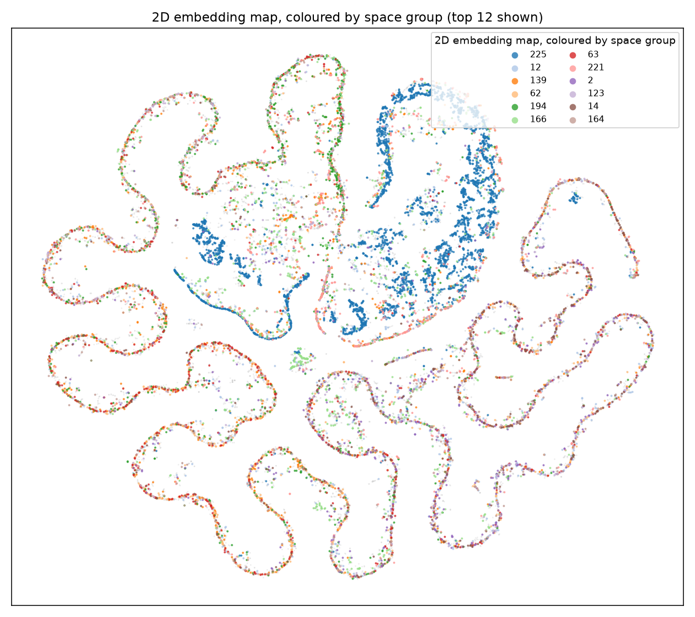
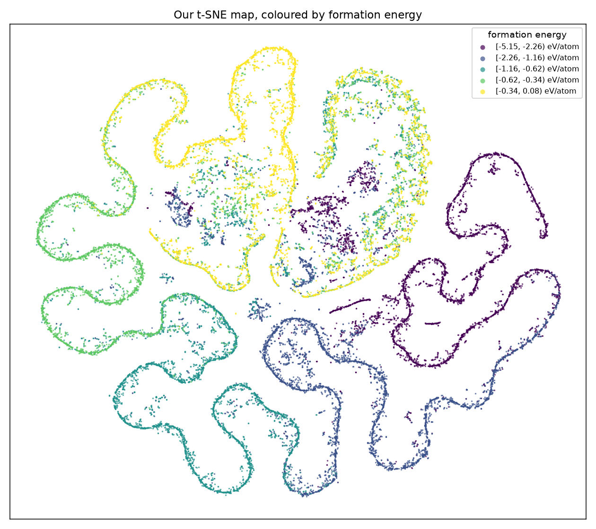

# Community organisation and property decodability

## Question and scope

Do communities constructed from Crys-JEPA embeddings associate with symmetry
labels, and can simple models recover selected properties from the embeddings?
This is a descriptive study of 27,136 known MP-20 reference crystals with
512-dimensional frozen embeddings. It does not evaluate generated candidates.

## Contribution relative to the earlier work

The existing energy-matched neighbour and geometry-only SOAP comparisons
already support geometric similarity among nearby JEPA embeddings, including
across chemical systems. This experiment extends the analysis from individual
neighbourhoods to graph communities and property decodability. Space group is
a symmetry label, not a direct geometry descriptor or a unique prototype.

The original paper explicitly describes structural information in its
embeddings ([Section 4.3, Information content](https://arxiv.org/html/2605.14759v1#S4.SS3)). The contribution here is an
empirical characterisation of that association, not the first suggestion that
structural information exists.

## Methods

- Union-symmetrized k=10 neighbour graphs with Gaussian weights, using raw and
  L2-normalized embeddings. The bandwidth is the median of all neighbour
  distances; this differs from the earlier screening graph convention.
- Louvain communities at resolution 1, with three seeds. Seed stability tests
  optimizer variation on one graph, not robustness to k or bandwidth.
- AMI, ARI and NMI against space-group and exact chemical-system labels, with
  20 label permutations. This null is unconditional on energy and composition.
- Descriptive between-group energy variance, with shuffled-label comparisons.
- Linear space-group and oxygen classifiers and ridge energy regression, with
  a random 75/25 row split. Scaling is fitted on probe-training rows only.
- PCA/t-SNE maps for illustration; visual islands and distances are not used
  as evidence of natural structural families.

## Interpretation

Community alignment above shuffled-label values supports non-random symmetry
association. Comparing space-group and chemical-system AMI describes these
particular labels; it does not rank all structural and chemical information.
Chemical systems are especially sparse: 11,695 of 16,549 systems have one row.

Successful probes support decodability under the stated random split. They do
not establish generalization to unseen chemical systems, exclude pretraining
exposure, or show structural information conditional on energy. Regression R2,
multiclass accuracy and binary accuracy are not comparable measures of which
property is encoded most strongly.

Energy variance by community or space group does not establish independence.
In particular, low between-space-group energy variance does not show that
structure is an independent embedding axis. An energy-only/composition baseline
or energy-conditioned permutation test remains necessary for that question.

## Results

Corrected rerun, 22 October 2026. Both graphs are connected.

| Graph | Communities | Space-group AMI | Chemical-system AMI | Seed-stability AMI |
| --- | ---: | ---: | ---: | --- |
| euclidean | 747 | 0.1487 | 0.0666 | 0.967-0.969 |
| cosine | 741 | 0.1482 | 0.0665 | 0.969-0.977 |

Shuffled-label AMI means are approximately zero. The 747/741 community counts
replace the earlier 748/744 values after rebuilding in float64 with explicit
self-exclusion and the recorded dependency versions. These counts are settings-
and implementation-dependent, not numbers of natural crystal families.

Between-community energy variance fraction is 0.941 (shuffled mean 0.027);
the corresponding space-group fraction is 0.176 (shuffled mean 0.006).
These are descriptive variance fractions, not an energy-independence test.

| Probe metric | Result | Baseline |
| --- | ---: | ---: |
| Space-group top-1 accuracy | 34.0% | 14.3% majority |
| Space-group top-5 accuracy | 58.5% | 32.3% five most frequent training labels |
| Space-group balanced accuracy | 8.1% | Mean recall over test-present classes |
| Energy R2 | 0.968 | Approximately zero, training-mean predictor |
| Oxygen-presence accuracy | 95.1% | 74.0% training-majority predictor |

The random split has 20,352 training and 6,784 test rows. Both classifiers
converged without recorded convergence warnings. Three test rows have labels
absent from probe training. The low class-balanced accuracy limits a broad
claim about space-group recovery; overall accuracy is weighted toward common
classes. Energy regression uses float64 SVD to avoid the earlier conditioning
warning. These probes remain uncontrolled for energy/composition confounding.

Numerical summaries and raw outputs are generated locally in
`reference_baselines/results/embedding_structure/` and are not committed.

## Limits and next questions

These experiments do not identify rock-salt, perovskite or other prototypes,
explain why screening succeeds, or demonstrate a benefit from graph-based
reference selection. Graph hyperparameter sensitivity and chemistry-grouped
probe splits remain untested. The optional truncated spectrum is diagnostic;
no natural cluster count is claimed.

A useful next comparison is geometry-only SOAP similarity within versus between
communities at matched energy differences. This would connect the community
analysis to the earlier neighbour-level structural hypothesis.

See [space-group concentration](structure_capture_experiment.md) for the
size-matched concentration analysis and [reproduction instructions](../embedding_structure/README.md).
