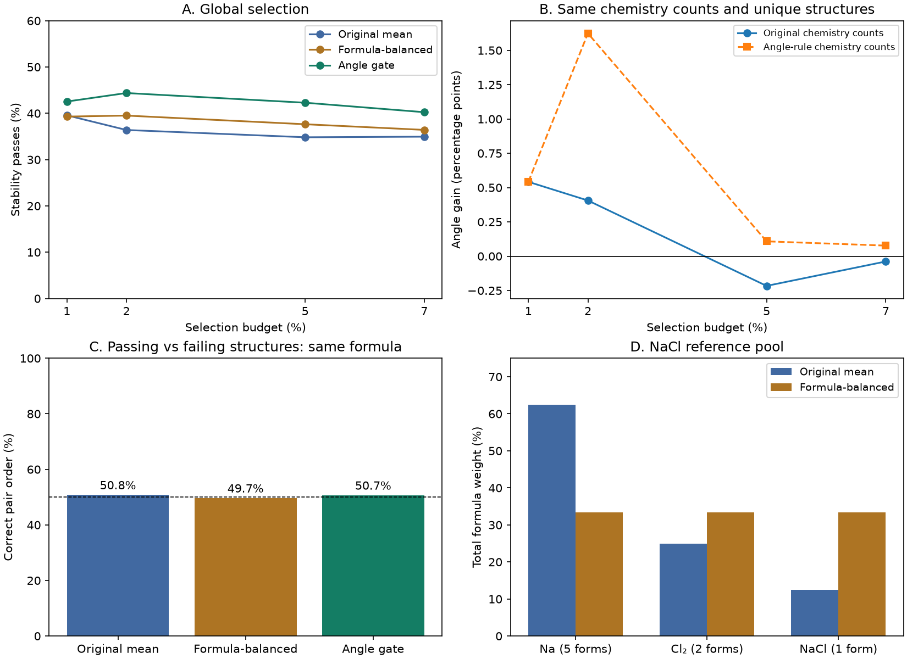

# Checks before GNN design — 22 October 2026

## Main finding

The angular screening gain is largely removed when both rules select the same chemistry mix.
This changes our interpretation: the existing evidence is strongest for choosing promising chemical systems,
rather than choosing better structures within each chemical system. This is a controlled diagnostic, not a causal proof.
No model training, new generation, DFT or new MatterSim relaxation was run in this study.



## 1. Balance repeated formulas

Every reduced reference formula gets equal total weight. If it has five known structures, each gets one fifth
of that formula's weight. The five structures remain separate. The reference pool and squared distance do not change.
For NaCl the known pool has five Na, two Cl2, and one NaCl structures. Na's weight falls from 5/8 to 1/3.

At test 5%, original plain mean gives 644 passes; formula-balanced mean gives 696; the angle gate gives 782.
Balancing formulas and applying the same angle gate gives 786. Thus simple formula balance helps globally,
but it does not account for the full angular-screening gain. At validation 5%, counts are 727, 803, and 857.

## 2. Hold the chemistry mix fixed

Both rules get exactly the same per-system counts and the same total budget. We repeat with allocations
from each rule, so the conclusion does not rely on only the original rule's preferred chemistry mix.
We also repeat with exact-formula quotas. Quotas use rankings and composition, never stability labels.

Greedy duplicate removal depends on ranking because structure matches need not be transitive. For matched
controls we therefore first fix a shared set of unique representatives in original-score order. All rules
then rank those same structures. This representative anchor is a limitation; global historical counts are
reported separately. Comparing matched and global counts without that distinction would be misleading.

### Test at 5%: 1,849 selections each

| Control | Original mean | Formula-balanced mean | Angle gate |
|---|---:|---:|---:|
| Original global comparison | 644 | 696 | 782 |
| Shared unique structures, global ranking | 644 | 695 | 759 |
| Same chemistry counts: original allocation | 644 | 650 | 640 |
| Same chemistry counts: angle allocation | 757 | 756 | 759 |
| Same formula counts: original allocation | 644 | 646 | 645 |
| Same formula counts: angle allocation | 772 | 761 | 759 |

Under original chemistry quotas, the test gate change is -4 passes; under angle chemistry quotas it is +2.
Both descriptive 95% uncertainty ranges include zero (-0.77 to +0.35 and -2.12 to +2.36 percentage points).
The validation result is not identical: its same-chemistry gains are +7 and +36 passes under the two anchors.
So we report both splits and all four budgets; we do not claim an exact universal decomposition of the gain.

## 3. Compare same-formula structures

Pairs were sampled with a fixed seed and at most 20 per formula, before using their energy labels.
Known structure-matched pairs were excluded. Tied or missing scores are excluded per method and coverage is reported.
For test pairs with different pass/fail labels, 4,622 pairs across 1,262 formulas are available.

| Ranking rule | Correct pair order | Mean accuracy across formulas |
|---|---:|---:|
| chemical_mean | 50.8% | 50.8% |
| chemical_weighted | 49.4% | 48.5% |
| formula_balanced_mean | 49.7% | 50.3% |
| nearest_angle | 49.6% | 50.5% |
| gate_then_chemical_mean | 50.7% | 50.9% |

These descriptive accuracies are close to 50%. The current scores do not show useful discrimination
between passing and failing structures of the same formula in this sample. This is not proof that no structural
signal exists. The earlier selected case studies include both wins and losses, and remain illustrative.
See [structures and examples](selection_interpretation.md#exact-composition-examples), including CIF and SOAP checks.

## 4. Rank directly by energy above hull

Direct ranking by the exact saved hull labels gives 1,849/1,849 passes at 5%. It gives 100% at all four
global budgets in this dataset. This is an oracle benchmark using the same labels that define a pass, not an
independent learned predictor. If these energies are already available, neither JEPA screening rule improves
the same-label stability yield over this direct ranking. Any practical advantage must be shown in another
setting, such as independent energy checks, missing hull references, or total pipeline cost.

## 5. Check the original encoder

The official model_1972 checkpoint was downloaded from the pinned release and verified with archive CRC and SHA256.
The public data/jepa listing contains mp.csv.gz and mptrj.csv.gz, but no mean_std_scaler.pt. No local scaler
or original embedding-extraction script was found. The scaler is not stored in the checkpoint.
Six equivalent representations were constructed for 16 seeded known crystals: identity, atom order, origin shift,
rigid rotation, lattice-basis permutation, and a doubled cell. Geometry equivalence and raw lattice-feature changes
were checked. These are feature checks, not evidence of encoder invariance.
All 96 variants match their original crystal under the structure matcher. Rigid rotation changes the six raw
lattice features by at most about 5e-6; basis permutations and doubled cells can change them substantially.
**Encoder status: blocked_exact_preprocessing_provenance.** Exact saved-embedding reproduction and encoder invariance remain pending.
The check accepts --scaler PATH and first verifies reproduction of the saved vectors before treating invariance as relevant.
A scaler estimated from MP20 would be a different preprocessing pipeline and has not been substituted.

## 6. What this means for later model design

- Do not describe the current gain as proof of better physical reference phases or better polymorph selection.
- Keep chemistry allocation and within-formula ranking as separate evaluation tasks.
- Keep separate nodes for different structures of the same formula; control their total readout weight.
- Distinguish chemical eligibility from cross-chemistry structural or energy context.
- Require a graph model to beat plain means, formula balance, weighting, the fixed angle gate, and chemistry-matched controls.
- Do not use candidate energies as input features if the goal is to predict those same stability labels.
- Check the original embedding provenance before treating graph training as ready.

The original JEPA loss uses formation-energy differences and a predictor conditioned on augmentation parameters.
Neither feature alone guarantees that raw encoder vectors are invariant or that smaller distance means lower energy above hull.
See [Crys-JEPA sections 4.1–4.2](https://arxiv.org/html/2605.14759v2#S4).
The separation between energy prediction, stability classification and discovery yield is also emphasized in
[Matbench Discovery](https://www.nature.com/articles/s42256-025-01055-1). We retain a fixed DFT reference hull
and separate same-label oracle screening from independent physical validation.

## 7. New evaluation set

The collection protocol is in configs/fresh_evaluation.toml: 40,000 new generations in 40 batches with a new
seed range. Model weights and all selection settings must be sealed first. No new set has been collected yet,
and no unseen-test gain is claimed. Final collection is a later experiment after model design and validation.

## Limits and reproduction

All numbers use the same saved MatterSim-relaxed structures and corrected energies against the fixed MP2023 hull.
The threshold is <=0.1 eV/atom. Current validation and test outcomes are already known; this is exploratory analysis.
Uncertainty ranges use 1,000 paired chemical-system bootstrap draws and are unadjusted for multiple comparisons.

Use the audit environment Python:

```sh
python -m reference_baselines.baselines.formula_balance
python -m reference_baselines.evaluation.pre_gnn
python -m reference_baselines.evaluation.matched_pairs
python -m reference_baselines.datasets.fetch_jepa_audit
python -m reference_baselines.checks.encoder_invariance  # add --scaler PATH when available
python -m reference_baselines.reporting.pre_gnn
```

All selection IDs, pool shares, comparisons and input hashes are local in results/pre_gnn/.
