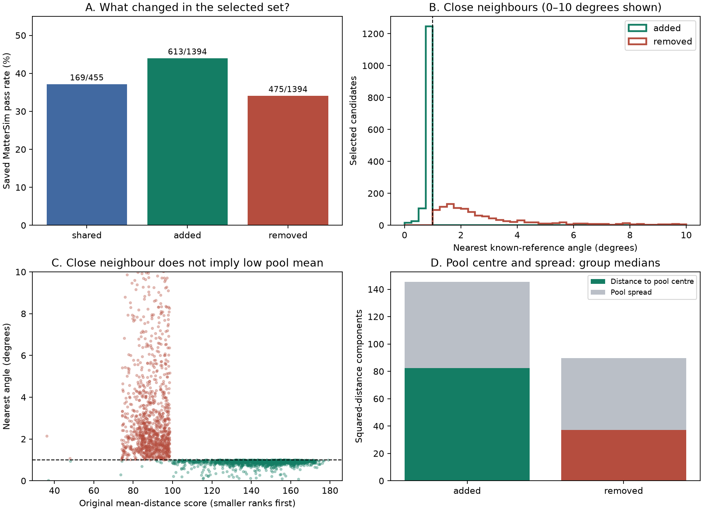
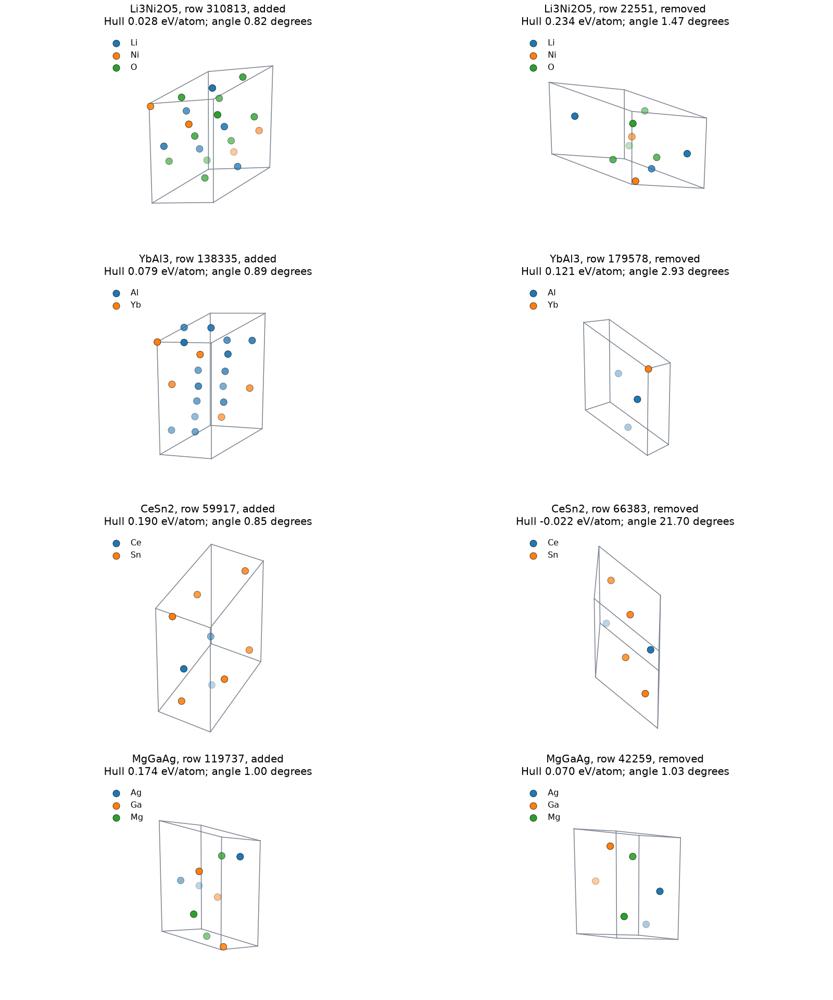
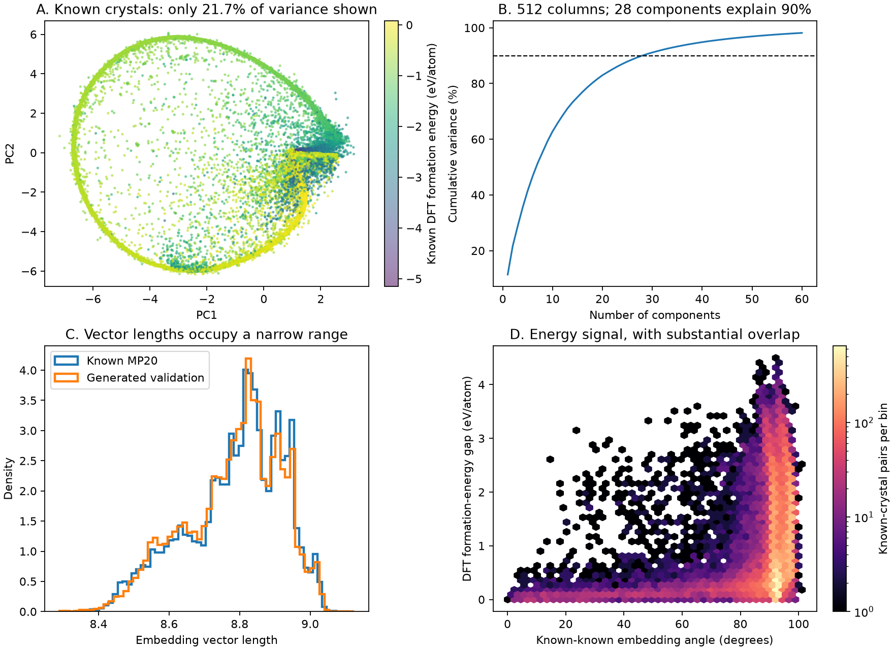

# Why the angle rule helped, and where it fails

This is an explanation of the fixed results. It does not tune another method on the opened test set.

## The gain is a swap, not new crystal generation

Both methods select 1,849 existing generated crystals. They share 455. The angle rule adds 1,394 and drops 1,394.
The added group has 613 saved MatterSim stability passes; the dropped group has 475. The shared group has 169. Thus 613 - 475 = 138 additional passes.

A crystal can pass geometry and composition checks while failing the stability cutoff. These are separate checks.

## Why the two rules choose different crystals

Original Crys-JEPA uses the mean squared distance to every eligible chemical reference. A close individual neighbour can be hidden by distant members of that pool.
The mean score equals distance to the pool centre plus the pool's internal spread. This is an exact identity, not a fitted explanation. It means the score depends on both the candidate and the reference pool's distribution.
Within an exact-composition pair, the reference pool and its spread are identical. The original ranking difference within that pair comes from distance to the same pool centre. Pool-spread differences matter when comparing candidates across different chemical systems.
For the added test group, the median original score is 145.7 and median pool spread is 62.9. For the dropped group, these are 89.6 and 52.5. Centre distance also differs; pool spread alone does not explain the gain.
The gate instead asks whether at least one known embedding is very close. Added candidates have median nearest angle 0.91 degrees; dropped candidates have 2.74 degrees.
Only 5.8% of added candidates have their nearest cosine reference in the original chemical pool. Most close references have different elements. They may provide structural or energy context, but cannot be physical decomposition phases with missing elements.

## Exact-composition examples

These examples are selected after seeing outcomes. They illustrate mechanisms; they do not estimate the frequency of each mechanism. Each pair has the same reduced formula. Pass means saved MatterSim hull distance <=0.1 eV/atom.

| Formula | Row | Selection | Original score | Nearest angle | Hull distance | Pass |
| --- | ---: | --- | ---: | ---: | ---: | --- |
| Li3Ni2O5 | 310813 | added | 110.39 | 0.82 degrees | 0.028 | yes |
| Li3Ni2O5 | 22551 | removed | 93.55 | 1.47 degrees | 0.234 | no |
| YbAl3 | 138335 | added | 161.85 | 0.89 degrees | 0.079 | yes |
| YbAl3 | 179578 | removed | 98.02 | 2.93 degrees | 0.121 | no |
| YbGa3 | 267519 | added | 148.46 | 0.88 degrees | 0.063 | yes |
| YbGa3 | 76528 | removed | 86.64 | 3.59 degrees | 0.149 | no |
| CeSn2 | 59917 | added | 106.14 | 0.85 degrees | 0.190 | no |
| CeSn2 | 66383 | removed | 92.31 | 21.70 degrees | -0.022 | yes |
| MgGaAg | 119737 | added | 125.49 | 1.00 degrees | 0.174 | no |
| MgGaAg | 42259 | removed | 81.15 | 1.03 degrees | 0.070 | yes |
| MgGaAg | 94292 | added | 136.06 | 0.91 degrees | 0.085 | yes |
| CuSe | 224026 | removed | 84.08 | 2.74 degrees | 0.037 | yes |

Li3Ni2O5 is a clear win: row 310813 passes at 0.028 eV/atom but has worse original score than removed row 22551, which fails at 0.234. Its close global reference is Li4Fe3(NiO5)2, outside the Li-Ni-O pool. A LiNiO2 reference in that pool has even closer geometry-only SOAP, despite a larger embedding angle. Embedding angle is therefore not identical to structural distance.
YbAl3 shows a reference-pool issue: five of its six eligible references are pure-element Al or Yb polymorphs, and only one is a compound (YbAl2). Equal reference weights therefore give five-sixths of the mean to elemental structures. The passing added candidate has original score 161.85, while the failing removed candidate has score 98.02. Its nearest global reference is UGaNi, which supplies cross-chemistry context, not a physical decomposition phase. This illustrates why chemical eligibility alone does not make a uniform mean informative.
CeSn2 is a counterexample: added row 59917 is only 0.85 degrees from a known reference, yet fails at 0.190 eV/atom. Removed row 66383 passes at -0.022 despite a nearest angle of 21.70 degrees. Even a same-element close reference does not guarantee stability at the candidate's composition.

Atoms and unit-cell edges are shown; bonds are not inferred. Different cell choices can make equivalent structures look different. Use CIFs and quantitative checks alongside these pictures.

## What the embeddings contain

The encoder returns one 512-number vector for a whole crystal. Its training loss uses cosine similarity and formation-energy differences. Its original screening score uses squared Euclidean distance. Neither is trained directly to give energy above hull.
Known vector lengths have a standard deviation of 1.55% of their mean. Direction is therefore a major source of distance variation. This helps explain why Euclidean and cosine nearest-neighbour results are similar; the main change here is local gating versus a whole-pool mean.
The first two PCA axes show only 21.7% of variance. The first ten show 62.8%; 28 components show 90%. This is structure in the representation, not proof that 28 physical variables explain stability.
Across 30,000 random known-crystal pairs, angle and absolute formation-energy gap have Spearman correlation 0.32. This supports an energy signal with substantial overlap. Similar formation energies across different chemistries do not imply similar energy above hull.
The most retrieved 1% of known references receive 5.6% of validation top-5 links. Some references are more popular, but a tiny group does not account for all retrievals.

## Are the additional crystals valid?

All 1,394 added test crystals pass finite-cell, periodic atom-distance, volume, and SMACT14 composition checks. These include charge-balance and electronegativity rules, with the same allowance for metal-only alloys. These are plausibility checks, not synthesis or phonon stability.
The dropped group has two composition-rule failures. Single-oxidation-state rules can reject real mixed-valence compounds, so these are review flags rather than proven invalid materials.
Passing the rule is also not a chemical proof: for Li3Ni2O5, one allowed SMACT14 assignment is Li(+1), Ni(+1), O(-1). This is only a charge-balance witness, not an identified oxidation state or bonding pattern. Chemistry review remains useful even for a passing composition.
Fresh MatterSim energy and force calculations were run for all 3,243 crystals in the union of the two selections, including every added crystal. No training was done.
Fresh single-structure stability counts: added 613, dropped 475, shared 169. Thus original selects 644 fresh passes and the angle rule selects 782.
A seeded and illustrative pilot re-relaxed 24 crystals with atoms and cell free to move. 24 met the force/cell convergence cutoff. This pilot is not a full-population re-relaxation result.
The later complete check re-relaxed all 3,243 selected crystals. All 1,394 added candidates converged; 635 pass stability after the extra relaxation. After validity, uniqueness, and convergence checks, the fixed angle selection has 808 unique stability passes versus 662 for the original selection, with no refill. See [full fresh validation](mattersim_validation.md) for the changed evaluation stage and all failure rules. The earlier 782-versus-644 result remains the frozen released-structure comparison.
The first multi-structure batched inference attempt was rejected: MatterSim 1.2.5's legacy graph batching produced results inconsistent with its individual ASE calculator. Accepted outputs use one graph per inference batch and are tested against the calculator. The rejected outputs are retained locally with a failure note and do not support any reported gain.

## What this suggests for a future model

The evidence supports learning how to combine a close local reference with chemical-pool context. It does not yet show that a GNN or transformer is required.
A useful model should distinguish reference roles: same-composition, same-system/subsystem, and cross-system context. It should see composition differences and local distances. Uniform averaging can hide a useful neighbour; a graph that averages indiscriminately could repeat that problem.
Start later with learned reference weighting and an explicit uniform-weight control. Add graph messages only if they help beyond that weighting and the fixed angle rule. Train and select on training/validation; reserve new generated data for a new unseen test. No new model or embedding transform was selected here.
Before training, check the original encoder on equivalent atom orders, translations, rotations, and unit-cell choices. This study uses saved vectors and has not established those invariances. A representation artifact should not be passed to a larger model as physical evidence.
The 1-degree threshold was chosen from validation results. It is not a universal chemical constant or a calibrated stability probability.

## Reproduce and inspect

Visible code: `evaluation/selection_audit.py`, `graphs/embedding_audit.py`, `structure/validity.py`, `structure/case_study.py`, `evaluation/mattersim_audit.py`, and `reporting/interpretation.py`.
Local tables, full reference IDs, CIFs, and checkpoint provenance are in `../results/interpretation/`. Original frozen metrics are unchanged.
Run the modules in that order, then this report module. SMACT and MatterSim use the separate ignored `environment/audit/` environment. The main environment and frozen baseline inputs were not replaced.

Sources: [Crys-JEPA energy-weighted cosine loss and screening](https://arxiv.org/html/2605.14759v2#S4), [SMACT composition-rule limits](https://smact.readthedocs.io/en/latest/examples/validity.html), [nearest-neighbour popularity in high dimensions](https://www.jmlr.org/papers/v11/radovanovic10a.html).
