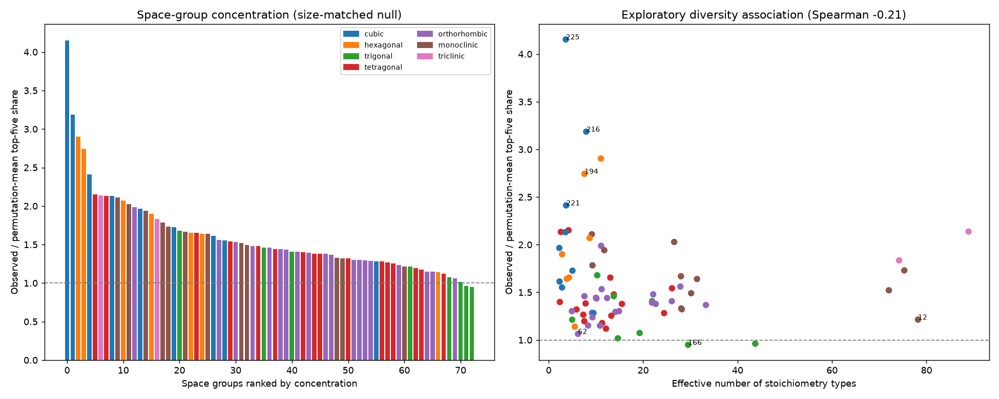

# Space-group concentration across embedding communities

## Question

Which space-group labels are more concentrated across embedding communities
than random label assignment predicts? This measures symmetry-label association,
not capture of a verified structural prototype or downstream screening value.

## Corrected method

For each space group with at least 50 crystals, measure the fraction of its
members in its five most populated communities. Permute community assignments
across crystals 1,000 times (seed 2026), preserving community sizes and group
counts. Reselect each group's five most populated communities in every draw.

Report observed share, permutation-mean share, their ratio, the 2.5th/97.5th
percentiles of the null distribution, one-sided permutation p-values with a
plus-one correction, and Benjamini-Hochberg q-values across the tested groups.
Null intervals are not confidence intervals for the observed effect.

The former universal 11.5% baseline did not account for selecting each group's
own top five communities, inflating ratios for smaller groups. Its categorical
"46 captured families" conclusion is withdrawn. We do not replace it with
another arbitrary captured/not-captured threshold.

## Composition-diversity check

Formulas are parsed using pymatgen, respecting parentheses, repeated elements,
and fractional amounts. Sorted, reduced element counts define a stoichiometry
type. The effective number of types is exp(Shannon entropy).

Correlations with concentration are exploratory marginal associations, not a
causal explanation or a control for energy. Stoichiometric diversity does not
measure geometric diversity: different geometries can share a stoichiometry,
and related geometries can have different stoichiometries. Individual p-values
for these exploratory correlations are reported without multiplicity correction.

## Results

Corrected rerun, 22 October 2026, on the rebuilt 747-community Euclidean graph.
There are 73 eligible space groups. 61 have BH q <= 0.05 under the unconditional
label-permutation null. Statistical association is not a binary measure of
whether a structural family is represented.

| Space group | Members | Observed top-five share | Null mean | Observed/null |
| --- | ---: | ---: | ---: | ---: |
| 225 | 3960 | 0.478 | 0.115 | 4.15 |
| 216 | 538 | 0.411 | 0.129 | 3.19 |
| 221 | 820 | 0.298 | 0.123 | 2.41 |
| 194 | 1129 | 0.331 | 0.121 | 2.74 |
| 13 | 57 | 0.404 | 0.226 | 1.78 |
| 198 | 67 | 0.418 | 0.213 | 1.97 |
| 62 | 1187 | 0.128 | 0.120 | 1.06 |
| 166 | 1076 | 0.115 | 0.121 | 0.95 |

The corrected stoichiometric-diversity correlation is rho = -0.212,
with unadjusted p = 0.072. This does not support the earlier strong
explanation that low concentration is mainly caused by heterogeneous labels.
The estimate differs from the earlier audit because the graph and communities
were also rebuilt. The formula parser fix and size-matched null are both applied.

Per-group ratios, null intervals, p/q values and provenance are generated in
`reference_baselines/results/embedding_structure/` and remain local.

## Conclusions and limitations

Space groups differ in concentration under this particular graph partition.
A high ratio supports concentration of that symmetry label. It does not identify
which structural prototypes are present. A low ratio does not prove the encoder
fails to represent structure, or that label heterogeneity is the explanation.

The previous conclusion that misses are heterogeneous labels rather than an
embedding failure is withdrawn. Energy-conditioned comparisons, stronger
geometry/prototype labels and graph-parameter sensitivity are needed to examine
that question. No screening outcomes are measured in this experiment.

See [reproduction instructions](../embedding_structure/README.md). The concentration outputs do not classify families as captured or missed.
